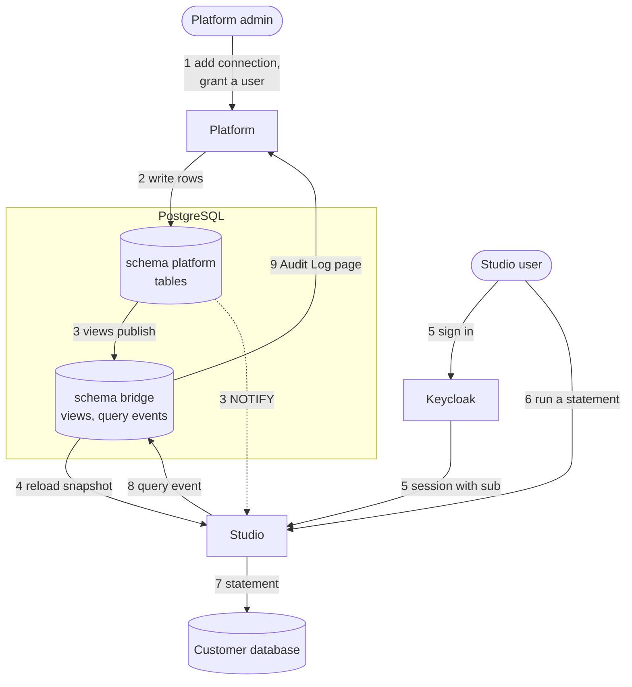
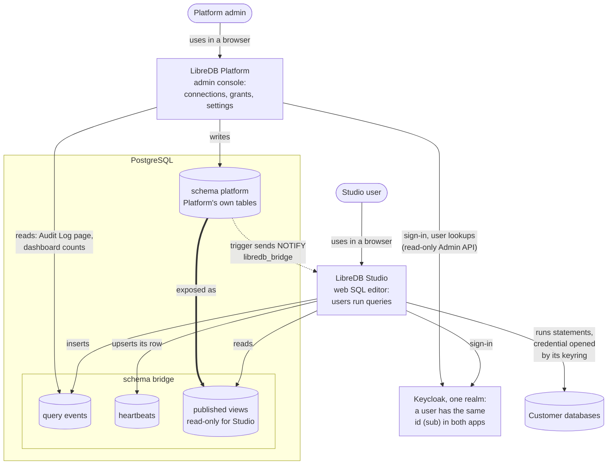
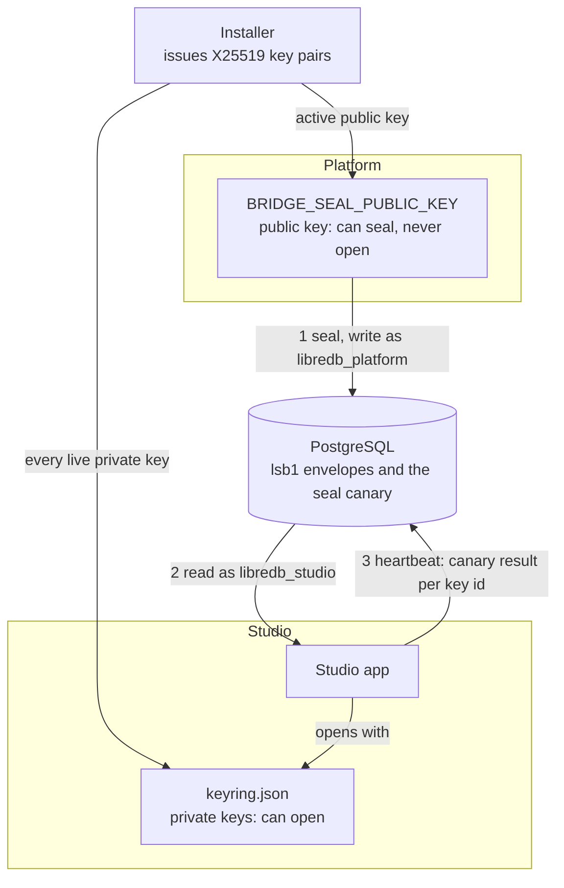
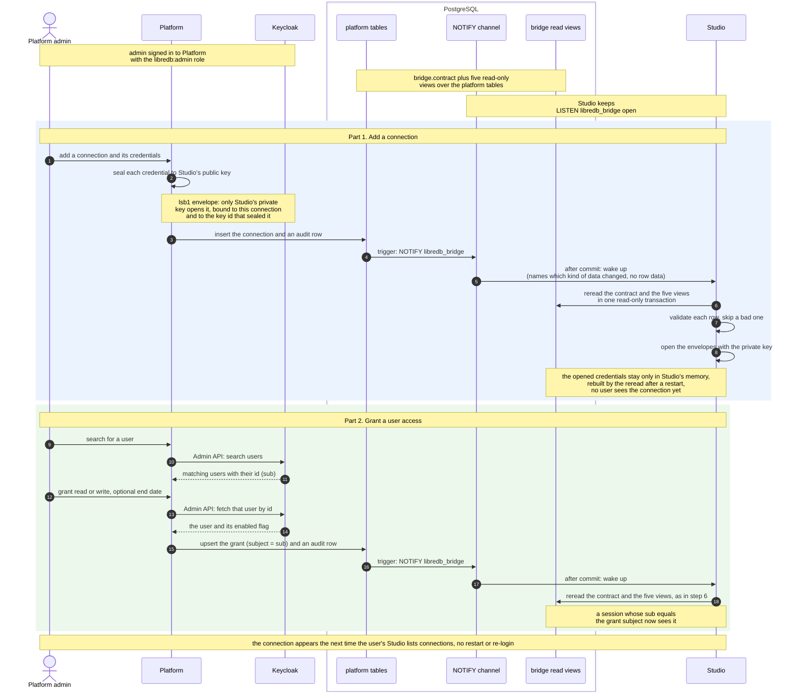
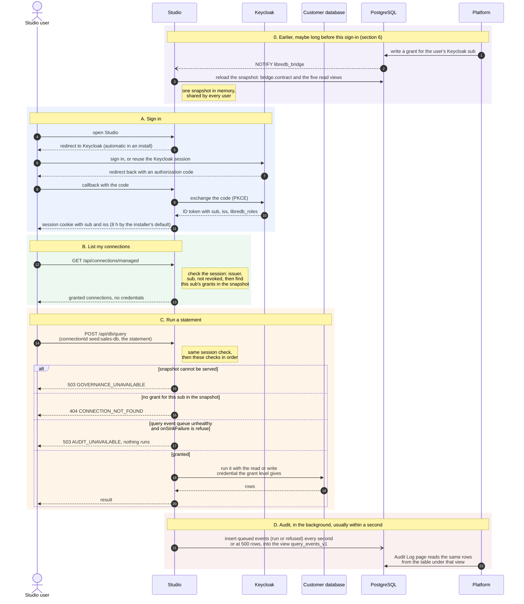
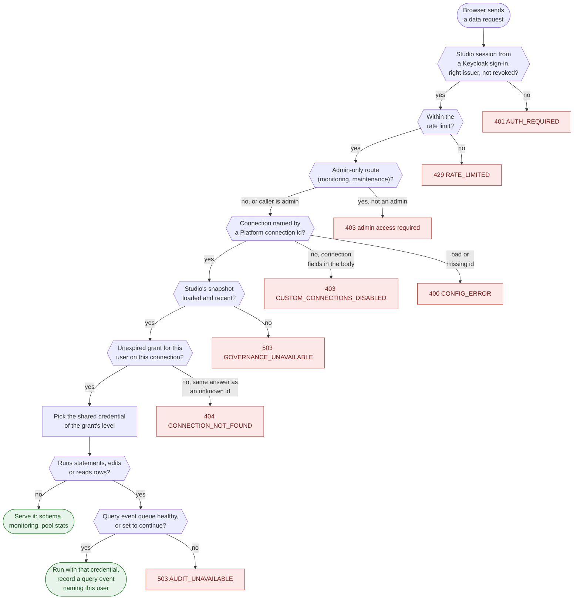
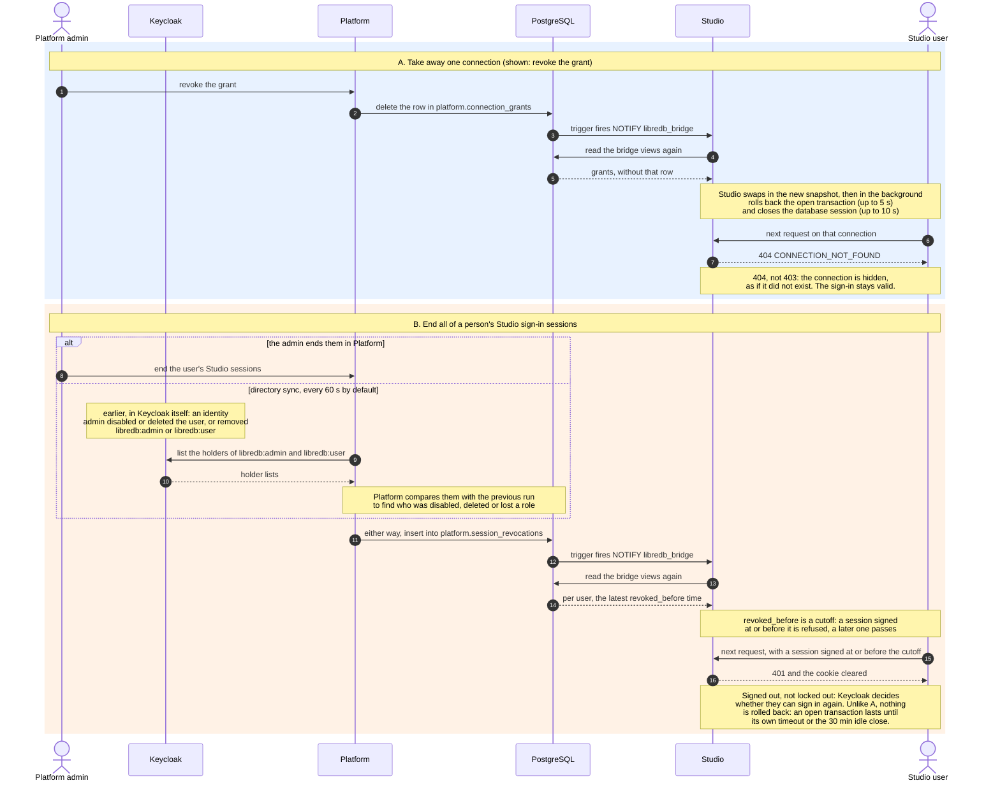
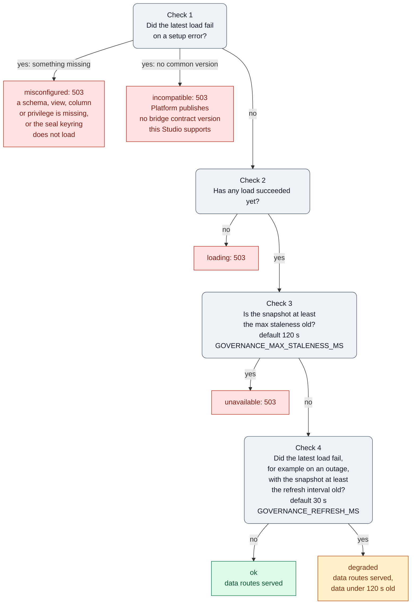
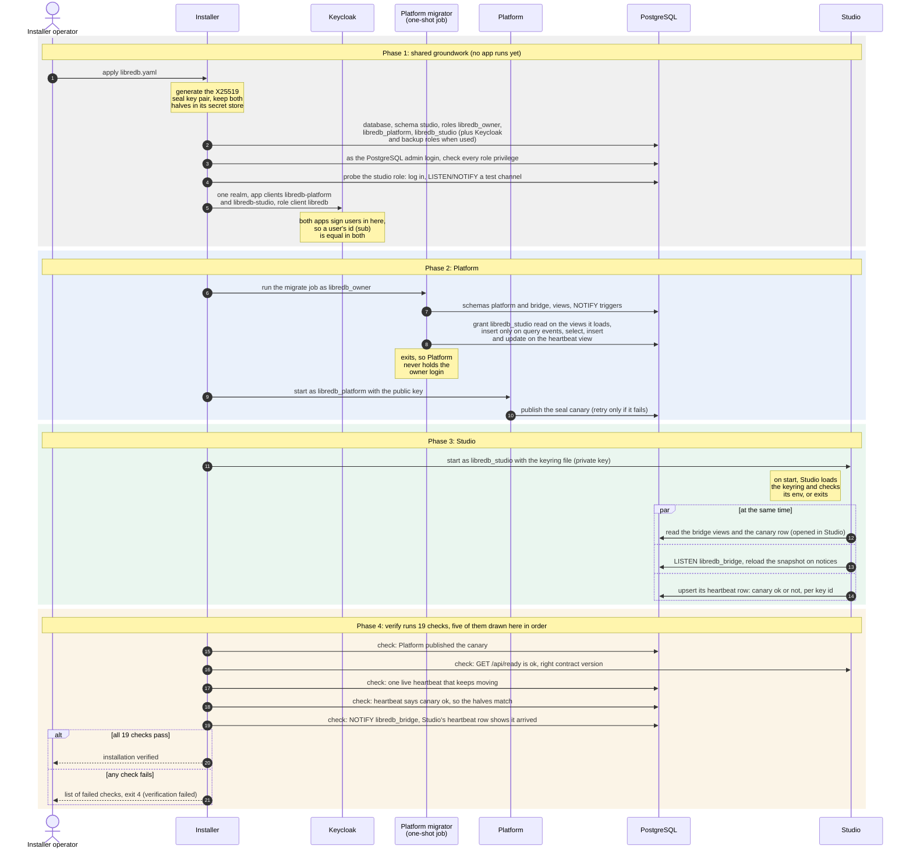

# How Platform and Studio work together

This page explains, with diagrams, how LibreDB Platform governs LibreDB Studio in an on-prem install.
It is a reading aid.
The contract itself is [Studio's `docs/GOVERNANCE.md`](https://github.com/libredb/libredb-studio/blob/1.0.0/docs/GOVERNANCE.md).
Every diagram and table follows the code of Platform in this repository and of [Studio 1.0.0](https://github.com/libredb/libredb-studio/releases/tag/1.0.0).
Terms such as snapshot, envelope, seal canary, governance mode and `seed:<id>` are defined in the [glossary](#14-glossary) at the end.

Five ideas carry the whole design:

- Platform and Studio never call each other over HTTP.
  They meet in one PostgreSQL database, where Platform publishes versioned views in schema `bridge` and Studio reads them.
- Each side connects with a role of its own: `libredb_platform` writes Platform's tables, and `libredb_studio` reads the views and writes only query events and heartbeats into the bridge, plus its own workspace storage in schema `studio`.
  A third role, `libredb_owner`, runs only Platform's migrations and is never held by a running app.
- Credentials are sealed to Studio's public key, which means they are encrypted with HPKE (Hybrid Public Key Encryption, RFC 9180) so that only Studio can decrypt them.
  Platform can seal and never open, and only Studio's keyring opens them.
- Both apps sign users in through the same Keycloak realm, so the Keycloak user id (`sub`) that Platform writes into a grant is the `sub` of the user's Studio session.
- Studio fails closed: when it cannot serve a snapshot, [data routes](#8-what-studio-checks-on-every-data-request) answer 503, and it never serves a snapshot older than `GOVERNANCE_MAX_STALENESS_MS` or an empty permission set in its place.

## 1. The whole loop: an admin grants, a user queries, Platform audits

An admin grants access in Platform, a user runs a statement in Studio, and Platform audits it.
Every arrow between the two apps goes through PostgreSQL.

1. The admin adds a database connection in Platform, which seals its credentials to Studio's public key, and grants a user read or write access, picking the user from Keycloak so the grant's subject is the Keycloak user id (`sub`).
2. Platform writes the rows into `platform.database_connections` and `platform.connection_grants` as role `libredb_platform`.
3. The views `bridge.connections_v1` and `bridge.grants_v1` publish those rows, and a trigger on each table sends `NOTIFY libredb_bridge` once the change commits.
4. Studio, which listens on that channel, reloads its whole snapshot from the bridge views in one read-only transaction and opens the sealed credentials with its keyring.
5. The user signs in to Studio through Keycloak, so the Studio session carries the same `sub`.
6. Studio lists only the connections that `sub` holds a grant on, and the user runs a statement on one of them.
7. Studio runs the statement on the customer database with the credential of the granted level.
8. Studio queues a query event for the statement and inserts it into the view `bridge.query_events_v1` with the next batch, which it sends every second.
9. Platform's Audit Log page reads the event from `bridge.query_event`, the table under that view, and shows who ran what, where and with what result.

Step 3 is not a call from Platform to Studio: PostgreSQL delivers the notification to Studio's listening connection, and the notification only tells Studio to reload.

## 2. The pieces and what connects them

A solid arrow from an app points at what that app reads or writes, and an arrow to Keycloak is the app calling Keycloak.
The thick arrow is not an action: Platform's migrations define the views in schema `bridge` over Platform's tables, so the tables are exposed as those views.
The dotted arrow is PostgreSQL's built-in change signal: a trigger sends NOTIFY, and Studio receives it on its LISTEN connection.
A cylinder is stored data: a database, a schema, or the tables and views inside one.

| What | Written by | Read by |
| --- | --- | --- |
| Connections, with credentials sealed (HPKE) to Studio's active public key, so only Studio's keyring opens them | Platform, as `libredb_platform` | Studio, as `libredb_studio` |
| Grants, settings, session revocations, the seal canary | Platform | Studio |
| NOTIFY on channel `libredb_bridge` after each change, telling Studio to re-read the views | Triggers on Platform's tables | Studio's LISTEN connection |
| Query events, insert only through the view `bridge.query_events_v1` over the table `bridge.query_event`, so Studio cannot read them back | Studio | Platform, from the table: the Audit Log page, dashboard and tenant activity counts, and the retention trim |
| One heartbeat row per Studio instance, updated on every beat through the view `bridge.studio_instances_v1` over the table `bridge.studio_instance` | Studio | Platform, from the table, which also removes rows unseen for 7 days |
| Studio's own saved queries, history and the rest of each user's workspace, in schema `studio` | Studio, as `libredb_studio` | Studio only: Platform never reads it |

The database roles, the Keycloak clients and the seal keys are not runtime pieces: the installer creates them, as [section 4](#4-trust-seal-keys-database-roles-and-keycloak-clients) and [section 11](#11-installation-how-the-installer-introduces-the-two-apps) describe.

## 3. Who does what

Four people touch an installation, and each one works in a different place.
Keycloak decides who may sign in, Platform decides what each Studio user sees and runs, and Studio enforces it.
One Keycloak role, `libredb:admin`, makes a person both a Platform admin and a Studio admin, and `libredb:user` makes them a Studio user only.

| Person | Where they work | How they sign in | What they can do | What they cannot do |
| --- | --- | --- | --- | --- |
| Platform admin | Platform's web console | Through Keycloak with the `libredb-platform` client, as an account whose `libredb_roles` claim holds `admin`. Platform checks the account again every `PLATFORM_SESSION_RECHECK_SECONDS` (default 300 s). The installer's first admin, `libredb-admin`, is one such account. | Add, edit or delete a connection, whose credentials Platform seals into an [envelope](#14-glossary). Grant a Keycloak user read or write on a connection with an optional end date, revoke a grant, or end a user's Studio sessions. Change or reset an [allowlisted Studio setting](#runtime-settings), and read the Audit Log page. | Read a saved credential back, or change anything in Keycloak: Platform's access there is read only. Grant write on a connection with no write credential, or grant anything to a disabled user. Turn on the agent or MCP, or keep someone out by ending their sessions alone. |
| Studio user | Studio's SQL editor | Through Keycloak with the `libredb-studio` client, as an account whose `libredb_roles` claim holds `admin` or `user`. Password, passkey and launch-token sign-in are off in [governance mode](#14-glossary). | See and open only the connections granted to them, admins included, and run statements with the credential of the grant's level. Hold an interactive transaction of their own. With the `admin` role, also open Studio's admin pages and monitoring. | See a connection without a grant, add one of their own, or see or join another person's transaction. Use the agent or MCP. Keep working after access is taken away ([section 9](#9-how-access-is-taken-away)). |
| Identity administrator | Keycloak's realm admin console | With a Keycloak account that holds the `realm-management` roles `manage-users`, `view-users`, `query-groups` and `view-clients`. With a managed Keycloak that is the installer's `libredb-user-manager`, and with an external Keycloak the site's own identity team. | Create, disable or delete users, and give or take away `libredb:admin` and `libredb:user`. When a user is disabled, deleted or loses a role, Platform's [directory sync](#9-how-access-is-taken-away) ends their Studio sessions on its next run. | Grant a connection, or decide what a user sees in Studio: that is the Platform admin's job. Sign in to Platform or Studio as `libredb-user-manager`, which holds no `libredb` role. |
| Installer operator | A shell on the host, as root | No sign-in to Platform or Studio. The installer reaches Keycloak's Admin API with a credential that depends on how Keycloak is provisioned, listed below. | Run `libredb-installer` `preflight`, `plan`, `apply`, `verify` and `status`. `apply` creates the database roles, the Keycloak clients and roles and the seal key pair, and a later `apply` converges again. `verify` runs every check and exits 4 when one fails. | Retire a seal key while an active connection's envelope still uses it. Reset the password of an account that already exists. Create a connection, a grant or a Studio setting: those are made in Platform. |

What the table leaves out, person by person:

- Platform admin.
  The recheck confirms that the account still exists, is enabled, holds the role and still has its session.
  Ending a user's sessions does not keep them out: a later sign-in still works unless Keycloak disables or deletes the user or takes away the role.
  The Studio settings `agent.enabled` and `mcp.enabled` are held off.
  Platform's connection form has no MCP field: the create and update actions accept an optional `mcpEnabled` input that defaults to false, and Platform stores and publishes it as `mcp_enabled` in `bridge.connections_v1`, where it has no effect while Studio keeps MCP off in governance mode.
- Studio user.
  A read grant does not block a write by itself: Studio runs the user's statements with the read credential, so a read grant only reads when that credential is a read-only database account, and Platform only asks the admin to confirm that it is.
  When access is taken away, Studio refuses a session that Platform ended, and when a grant goes it closes the user's database sessions on that connection and rolls back their open transaction.
- Identity administrator.
  With a managed Keycloak, `libredb-user-manager` reaches the console through the SSH tunnel that `libredb-installer keycloak console` prints, and sets a new password and a TOTP device at the first login.
  A role given to `libredb-user-manager` converges back on the next `apply`.
  Directory sync runs every `DIRECTORY_SYNC_INTERVAL_SEC` (default 60 s).
- Installer operator, Keycloak credential.
  For a managed Keycloak the installer uses the service client `libredb-installer`, whose secret it keeps in the root-only file `installer.env`.
  For an external Keycloak with `provisioning: installer` (the default) it uses the site's admin credential, read on each run and never stored.
  With `provisioning: manual` it holds no Keycloak admin credential and only checks the realm from outside with the two app client secrets.
- Installer operator, `apply`.
  For a managed Keycloak it also creates the realm and the two first accounts, with temporary passwords in root-only files.
  The private seal key goes into Studio's keyring and the public key to Platform.
  When the site provisions PostgreSQL or Keycloak itself (`provisioning: manual`), a DBA first runs the script that `libredb-installer db-script` prints, or the site sets up the realm from `libredb-installer keycloak export`, and `apply` only checks the result, while the seal keys stay the installer's.
  A later `apply` rotates seal keys only when `bridge.sealKeys` asks for it: by default it issues no new key and retires none.
- Installer operator, retiring a key.
  The retire guard looks for envelopes only in `bridge.connections_v1`, which publishes connections that are active and not deleted.
  A deactivated connection still sealed to the key is not found, so `apply` retires the key, and if that connection is reactivated later, Studio skips it with `READ_SECRET_UNOPENABLE`.

## 4. Trust: seal keys, database roles and Keycloak clients

Platform and Studio never trust each other directly.
Each one trusts what the installer set up for it: its own PostgreSQL role, its own Keycloak client, and its side of the seal keys.
Platform holds the public half of the active seal key, and Studio holds the private half of every live seal key.

### Who holds which key

| Holder | What it holds | What that lets it do |
| --- | --- | --- |
| Studio | The X25519 private keys, in the keyring file named by `GOVERNANCE_PRIVATE_KEYS_FILE` (`/etc/libredb/governance/keyring.json`), 1 to 16 keys. | Open every `lsb1` envelope sealed to one of its keys. |
| Platform | One X25519 public key in `BRIDGE_SEAL_PUBLIC_KEY`. | Seal credentials. Platform has no code that opens an envelope, and a test in its suite fails if any appears. |
| Installer | Every key pair it issued, in its secret store, live or retired. | Write every live private key into Studio's keyring, give Platform the public half of the active key only, and rotate keys on a later `apply`. |
| PostgreSQL | Only envelopes. | Nothing: a database reader sees ciphertext, never a password. |

The key id (`kid`) is the first 8 bytes of the SHA-256 of the raw public key, written as 16 hex digits.
Several keys can be live at once, and Studio's keyring holds all of them, so a key can be rotated without breaking envelopes sealed to the old one.
The active key is the live key named by `bridge.sealKeys.activeKid`, or else the oldest live key.
So a newly issued key reaches Studio's keyring before Platform seals with it.
Studio reads the keyring once, when it starts, so a changed keyring takes effect when Studio restarts.
Studio refuses to start in governance mode when the keyring file does not load.

### What an lsb1 envelope is bound to

An envelope looks like `lsb1.<kid>.<enc>.<ciphertext>`.
It is HPKE (RFC 9180) with X25519, HKDF-SHA256 and AES-256-GCM, with a fresh ephemeral key on every seal.
Its plaintext is one credential set, such as a user and a password, for one level of one connection.
Its authenticated data binds it to:

- the connection id,
- the level, `read` or `write`,
- the engine,
- the key id,
- the SHA-256 of the connection definition (host, port, TLS settings and the other non-secret fields) in RFC 8785 canonical JSON.

So an envelope only opens in the row it was sealed for.
If anyone with write access to the database copies it to another connection, points the connection at another host, or weakens its TLS settings, Studio's open fails with `AUTH_FAILED`.

### PostgreSQL roles

| Role | Used by | May touch |
| --- | --- | --- |
| `libredb_owner` | Platform's migrate job (`MIGRATE_DATABASE_URL`), never the running app | Owns schemas `platform` and `bridge` and runs every migration. |
| `libredb_platform` | Platform at runtime (`DATABASE_URL`) | Reads and writes most tables in `platform`, with no DDL. `platform.admin_actions` is append-only for it (insert and select), and `platform.studio_setting_keys` is read-only, since only migrations write it. Reads the views `contract`, `seal_canary_v1`, `connections_v1`, `grants_v1`, `settings_v1` and `session_revocations_v1`. Reads Studio's writes from the base tables: selects `bridge.query_event`, selects and deletes `bridge.studio_instance`, and trims old events through `bridge.trim_query_events`. |
| `libredb_studio` | Studio (`GOVERNANCE_POSTGRES_URL` and `STORAGE_POSTGRES_URL`, one URL on the same database as Platform) | Reads the views `contract`, `seal_canary_v1`, `connections_v1`, `grants_v1`, `settings_v1` and `session_revocations_v1`. Inserts into `query_events_v1` but cannot read its events back. Selects, inserts and updates `studio_instances_v1`: the grant covers every instance's row, since the view has no row filter, so keeping to its own row is how Studio behaves (it upserts on its `instance_id`), not something the database enforces, and the installer's `verify` relies on reading every row as `libredb_studio`. Owns schema `studio` for its own storage. It has no access to schema `platform`. |

The installer also creates `libredb_keycloak` when it runs Keycloak itself, and `libredb_backup` for customer backups when the admin role can grant it.

### Keycloak

One realm serves both apps.
It has two app clients, `libredb-platform` and `libredb-studio`, and a third client, `libredb`, that only holds the two roles `admin` and `user`.
This page writes them as `libredb:admin` and `libredb:user`: client `libredb`, role `admin` or `user`.
The client scope `libredb-roles` writes the roles a user holds into the ID token claim `libredb_roles`.

- Platform admits only an account whose `libredb_roles` holds `admin`.
  Its client also has a service account with `view-users` and `view-clients`, which it uses to read the directory.
- Studio admits an account that holds `admin` or `user`, and refuses an account with neither.
- Both apps key a user by the Keycloak user id (`sub`), so the subject Platform writes into a grant is the `sub` of the user's Studio session.
- With `mobile.enabled: true` in the installer's configuration, the realm also has the public client `libredb-mobile` of the mobile app, whose access token carries the audiences `libredb-studio-api` and `libredb-platform-api` and `libredb_roles`.
  Studio accepts that token as a bearer session through `OIDC_BEARER_AUDIENCE` and `OIDC_BEARER_CLIENT_IDS`, under the same governance rule as a session cookie, and its `sub` is the same Keycloak user id.
  Platform accepts the same token on its API under `/api/v1` through `PLATFORM_API_AUDIENCE` and `PLATFORM_API_CLIENT_IDS`, which the installer writes into `platform.env` with `mobile.enabled: true`, and only for an account with the role `admin`.

### The seal canary

The canary proves that Platform's public key belongs to a private key in Studio's keyring, before any real connection exists.

1. When Platform starts, it seals `{"user":"libredb-canary"}` for connection `canary`, level `read`, engine `canary` and definition `{}`, and inserts it into `platform.seal_canary` under its key id, once per key id.
2. Studio reads it through `bridge.seal_canary_v1` on every snapshot load and opens it with its keyring.
3. Studio writes the result for each key id, `ok` or the error code, into the `canary` column of its heartbeat.
4. The installer's `verify` checks that every live Studio instance reports `ok` for the key id of `BRIDGE_SEAL_PUBLIC_KEY`.

A wrong public key in Platform therefore shows up as a failed canary at install time, not as a connection that will not open later.

## 5. What lives in schema bridge, and who reads and writes it

The flows below name these views and notification kinds, so they are listed here first.

| Object | Written by | Read by | Holds |
| --- | --- | --- | --- |
| `contract` | Platform's migrations | both | The published contract version and the notify channel. |
| `connections_v1` | Platform, through `platform.database_connections` | Studio | Active connections, with sealed read and write credentials. |
| `grants_v1` | Platform, through `platform.connection_grants` | Studio | One effective grant per subject and connection: level and end date. |
| `settings_v1` | Platform, through `platform.studio_settings` | Studio | The runtime settings, such as the query timeout and the statement capture mode. |
| `session_revocations_v1` | Platform, through `platform.session_revocations` | Studio | The latest revocation time (`revoked_before`) per subject. |
| `seal_canary_v1` | Platform, through `platform.seal_canary` | Studio | One sealed test envelope per key id. |
| `query_events_v1` | Studio, insert only, through this view over the table `bridge.query_event` | Platform, from the table `bridge.query_event` | One row per executed unit. |
| `studio_instances_v1` | Studio, each heartbeat, through this view over the table `bridge.studio_instance` | Platform, from the table `bridge.studio_instance` | Each instance's version, keyring, listener, snapshot age and query event queue state. |

A statement-level trigger on each Platform table behind a read view sends `NOTIFY libredb_bridge` with the view's kind once the change commits.
Studio folds the notifications of each 250 millisecond window into one reload of its whole snapshot.

### Runtime settings

Runtime settings reach Studio through `bridge.settings_v1`, like every other row.
The Platform admin changes an allowlisted key, Platform publishes it in `bridge.settings_v1`, and Studio checks every row against its settings registry on each snapshot load.
The keys are `ai.enabled`, `agent.enabled`, `mcp.enabled`, `query.timeoutMs`, `provider.poolMaxPerUser`, `queryLog.statementCapture`, `queryLog.maxStatementBytes` and `queryLog.onSinkFailure`.
A valid value wins over its environment counterpart.
An invalid value is ignored and reported in the heartbeat and on Studio's admin status as a `SETTING_INVALID` skip, and the environment value or the default applies.
The last snapshot's values stay in force while a later load fails.
`query.timeoutMs` applies from the next request after the snapshot that carries it, and `provider.poolMaxPerUser` applies to database sessions opened after the change.
Security posture, such as sign-in, keys and session lifetime, is never a runtime setting and stays in the environment.

## 6. How a connection and a grant reach Studio

Platform never calls Studio: it writes to its own tables, a trigger sends a NOTIFY that only wakes Studio up, and Studio rereads its read views in schema `bridge`.
A new connection is invisible to every user until part 2 grants it to someone.

| Step | Who refuses | When |
| --- | --- | --- |
| 1 | Platform | the license is invalid or has expired, or more user seats are in use than it allows (see the [License section](deploy/platform-runtime.md#license) of the runtime guide), or the admin has not confirmed that the read credential can only read |
| 9, 12 | Platform | the session cannot read the Keycloak directory |
| 12 | Platform | write is asked but the connection has no write credential, Keycloak has no user with that id, the user is disabled, the end date is not in the future, or the grant would give a user who holds no user seat access to an active connection while the license is invalid or has expired or every user seat is in use |
| 7, 8 | Studio | the row breaks a contract rule of `docs/GOVERNANCE.md`, for example a malformed or repeated id, an engine Studio does not serve, an engine that opens a local file, or one outside `GOVERNANCE_ALLOWED_ENGINES` (six engines by default when it is unset, as the installer leaves it), a definition key outside the allowlist or holding a credential, or a read envelope that does not open: the row is skipped with a code. A write envelope that does not open leaves read access only |
| list | Studio | the snapshot cannot be served: `503 GOVERNANCE_UNAVAILABLE`, never an empty list |

## 7. How a user signs in and runs a statement

Studio never calls Platform here: it matches the Keycloak subject (`sub`) in the user's session against the grants Platform published in the bridge views, which Studio keeps in memory as its snapshot.
A governed connection travels as `seed:` followed by its connection id, because governance reuses the path Studio already has for operator-defined connections from a seed file ([section 12](#12-where-studios-connections-come-from)).
Each statement that runs is queued as a query event for Platform's Audit Log page.

Here `seed:sales-db` stands for `seed:` followed by any connection id.

Sign-in can fail at the callback, and then Studio sets no cookie:

| Studio answers | When |
| --- | --- |
| `/login?error=oidc_no_claims` | the ID token has no `sub` or no `iss` string |
| `/login?error=oidc_config` | an empty `sub`, or an `iss` other than `OIDC_ISSUER` |
| `/login?error=oidc_no_role` | `libredb_roles` holds neither `admin` nor `user` |
| `/login?error=oidc_session_revoked` | the subject's latest `revoked_before` is at or after the current second, as when Platform's clock runs ahead of Studio's or the row's `revoked_before` cannot be read |

The refusals in parts B and C, every other answer a data request can get, and which of them leave a query event are in the next section.

## 8. What Studio checks on every data request

This chart applies only in governance mode: every data request passes these gates top to bottom, and the first gate that fails answers with the red box beside it.
The table under the diagram says what each answer means and whether it leaves a query event for the Audit Log page.

| Answer | When | Query event |
| --- | --- | --- |
| 401 AUTH_REQUIRED | No session, a local password session, an issuer other than `OIDC_ISSUER`, or a session Platform revoked. Revocation is checked only while the snapshot is servable; without one the request gets the 503 GOVERNANCE_UNAVAILABLE instead. A session that verifies but is refused has its cookie cleared; a missing, expired or badly signed token leaves the cookie as it was. | None |
| 429 RATE_LIMITED | The session's user has spent the `query` bucket's budget for the current window. The answer carries `Retry-After`. | None |
| 403 admin access required | Monitoring or maintenance asked by a session without the admin role. A grant alone never opens these routes. | None |
| 403 CUSTOM_CONNECTIONS_DISABLED | The request carries its own connection details instead of an id. Custom connections are always off in governance mode. | None |
| 400 CONFIG_ERROR | The `connectionId` is empty, not a string or not `seed:<id>`, or the body has neither a connection nor a `connectionId`. Answered at the same gate as the 403 above, after the session, rate-limit and admin checks. | None |
| 503 GOVERNANCE_UNAVAILABLE | The snapshot is not `ok` or `degraded`: still loading, older than `GOVERNANCE_MAX_STALENESS_MS`, misconfigured or incompatible (see [section 10](#10-how-fresh-studios-snapshot-is)). Never an empty list in its place. | One `refused` event, from the editor query and multi-query routes only, and only for a well-formed `seed:` id (1 to 64 lowercase letters, digits or hyphens) |
| 404 CONNECTION_NOT_FOUND | No unexpired grant for this Keycloak user id: the grant is missing, expired by Studio's clock or held by another `sub`, or Studio left the connection out of its snapshot (such as an engine it does not admit, a definition it refuses, or a read credential it cannot open), so a grant Platform shows can still answer 404. Deliberately the same answer as a connection that does not exist, so it reveals nothing. A write credential Studio cannot open only lowers a write grant to read. | One `refused` event, from the editor query and multi-query routes only, and only for a well-formed `seed:` id (1 to 64 lowercase letters, digits or hyphens). A `seed:` id outside that format still answers 404 and records nothing. |
| 503 AUDIT_UNAVAILABLE | Setting `queryLog.onSinkFailure` is `refuse` (default `continue`, which runs the statement anyway) and the query event queue is backing off after a failed insert or is at least 90% of its 10000 events full. Nothing runs. | One `refused` event, except on the transaction route, which records none |
| 409 TRANSACTION_CREDENTIAL_CHANGED | Transaction route only: the open transaction began under a grant level or credential that has changed since. Studio rolls it back. | The transaction's `rolled-back` event |
| Run | The statement or read runs with the connection's shared credential of the grant's level, never a database login of the user; the user appears only as the query event's principal. It runs on a pool of this user's own, keyed by `sub`, so no session state passes between users. A write grant carries the write credential only where this Studio instance opened it when the snapshot loaded. | One per statement (editor, multi-query, transaction), per object edit, maintenance action or profile run, and per key-scan page. Under the default `continue`, when the query event queue is full (10000 events), the new event is dropped while the statement still runs. |

A request that Studio rejects as malformed, such as one with no statement, a bad option or console text over the size limit, gets 400 or 413 after the grant gate and before the query event queue gate, and records nothing, because nothing ran.

## 9. How access is taken away

Platform takes access away either from one connection (A, the user then gets 404) or from the whole person (B, the user then gets 401), and in both cases it only changes rows in its own tables.
Studio sees the change when it reloads its snapshot and refuses the person's next request.

| Trigger | Path | The person's next request | Can they get back in? |
| --- | --- | --- | --- |
| Grant revoked | A | 404 `CONNECTION_NOT_FOUND` | Only with a new grant |
| Connection deleted (no restore) | A | 404 `CONNECTION_NOT_FOUND` | Only with a new connection and a grant on it |
| Grant expired (no NOTIFY: Studio checks `expires_at` on every request, and the next reload, periodic or prompted by any notification, closes their database session) | A | 404 `CONNECTION_NOT_FOUND` | Only with a new grant |
| Grant level changed, or the credential sealed again | A | 409 `TRANSACTION_CREDENTIAL_CHANGED` if a transaction was open | Yes, at the new level |
| Admin ends the sessions | B | 401, cookie cleared | Yes, by signing in again, unless Keycloak also blocks them ([known limitation 1](#13-known-limitations)) |
| Disabled or deleted in Keycloak | B, through directory sync | 401, cookie cleared | No, while the user stays disabled ([known limitation 4](#13-known-limitations)) |
| `libredb:admin` or `libredb:user` removed in Keycloak | B, through directory sync | 401, cookie cleared | Only with a role they still hold ([known limitation 3](#13-known-limitations)) |

## 10. How fresh Studio's snapshot is

One load fills the snapshot by reading `bridge.contract` and the five read views in one read-only transaction: `contract` first (the contract versions Platform publishes), then connections, grants, settings, session revocations and the seal canary.
Studio loads again in the background after a NOTIFY, at most one load per 250 ms.
Without any notification, Studio also reloads whenever its snapshot reaches `GOVERNANCE_REFRESH_MS` (30 s by default), so a lost notification costs at most that long.
While there is no snapshot, or it is at least `GOVERNANCE_REFRESH_MS` old, Studio loads every 4 to 6 s until a load succeeds.
Every data request and every `GET /api/ready` runs the checks below, so the first load that succeeds puts Studio back in `ok`.

| State | Data routes | `GET /api/ready` |
| --- | --- | --- |
| `ok` | served | 200 `ok` |
| `degraded` | served, the status page shows the last load error | 200 `degraded` |
| `unavailable` | 503 `GOVERNANCE_UNAVAILABLE` | 200 `degraded`, so an admin can still reach the status page |
| `loading` | 503 `GOVERNANCE_UNAVAILABLE` | 503 `loading` |
| `misconfigured` | 503 `GOVERNANCE_UNAVAILABLE` | 503 `misconfigured`, naming the object or the keyring variable |
| `incompatible` | 503 `GOVERNANCE_UNAVAILABLE` | 503 `incompatible`, listing both version sets |

## 11. Installation: how the installer introduces the two apps

The installer gives Platform the public half of one seal key pair and Studio the private half, then proves the halves match: Platform seals a known test value (the seal canary, [section 4](#the-seal-canary)), and only the matching private key can open it.
The roles it creates, and what each may touch, are in [section 4](#postgresql-roles).

The same signals stay visible after installation, so they are where to look when something breaks:

- `libredb-installer verify` runs every check again and exits 4 when one fails.
- Studio's `GET /api/ready` answers with the freshness state of [section 10](#10-how-fresh-studios-snapshot-is).
- Studio's admin Overview page, from `GET /api/admin/governance`, shows the freshness, the latest load error, the number of admitted connections, the skipped rows with their codes, the keyring key ids, the seal canary result per key id, the listener state and the query event queue state.
- Each Studio instance's heartbeat row, written through `bridge.studio_instances_v1` and kept in the table `bridge.studio_instance`, shows its listener state, the time of its last snapshot load, its skipped rows, its canary result per key id and its query event queue state.

## 12. Where Studio's connections come from

| | A user's own connection | Seed file | Governance |
| --- | --- | --- | --- |
| Kept in | The browser, synced to Studio's server storage | The operator's YAML file, `SEED_CONFIG_PATH` | The bridge snapshot in Studio's memory |
| A request sends | The whole connection, credentials included | Only the id, `seed:<id>` | Only the id, `seed:<connection_id>` |
| Who sees it | The user who saved it | Users whose role the entry allows | Users who hold an unexpired grant |
| Credentials come from | The request | The file, with `${ENV}` and Vault references resolved | The read or write envelope, by grant level, used as written |
| In governance mode | Refused with 403 | Not read | The only source |

Governance reuses the seed path.
One module, Studio's `src/lib/governance/visible.ts`, is the single dispatcher, answering from the seed file without governance and from the snapshot with it.
Its `visibleConnections` answers the connection list (`GET /api/connections/managed`), and its `visibleConnectionById`, which `resolveConnection` calls, answers the routes that open a connection by id.
So Studio's routes and editor treat a governed connection as a `seed:` connection.

## 13. Known limitations

These limitations follow from the design of this release, and an admin who takes access away should know them.

1. Ending a person's Studio sessions signs them out but does not keep them out.
   A sign-in after the revocation gets a session that the revocation does not refuse, so with `OIDC_PROMPT=omit` and `OIDC_AUTO_REDIRECT` on, a user whom Keycloak still enables is signed in again at once.
   To keep someone out, disable the user in Keycloak or remove their `libredb:admin` and `libredb:user` roles.
   This is why path B of [section 9](#9-how-access-is-taken-away) signs a person out without locking them out.
2. While Studio cannot serve its snapshot, it refuses no session for a revocation, because every data route answers 503 instead, so a revoked person reaches no customer database and an outage of the bridge sets off no wave of sign-ins.
   [Section 8](#8-what-studio-checks-on-every-data-request) shows the effect on data routes: revocation is checked only while the snapshot is servable.
3. Directory sync sees `libredb:admin` and `libredb:user` held directly or through a group and its subgroups, but not through a composite role, so a user who holds a role only through a composite role is never revoked.
   Such an assignment is unsupported, as the [Keycloak contract](deploy/platform-runtime.md#keycloak-contract) of the runtime guide says.
   This affects the directory sync branch of [section 9](#9-how-access-is-taken-away).
4. Disabling a user in Keycloak leaves their grants in place, so enabling the user again restores their access without a Platform write, and the user keeps a user seat meanwhile, as the [License section](deploy/platform-runtime.md#license) of the runtime guide says.
   The "No" for a disabled user in the table of [section 9](#9-how-access-is-taken-away) holds only while the user stays disabled.

## 14. Glossary

The diagrams use these terms without stopping to explain them.

| Term | Meaning |
| --- | --- |
| Governance mode | Studio run with `GOVERNANCE_SOURCE=postgres` and a `GOVERNANCE_POSTGRES_URL`: its connections, grants and runtime settings then come only from Platform through the bridge views, and custom connections, password sign-in, the agent and MCP are off. |
| Snapshot | Studio's in-memory copy of `bridge.contract` and the five read views (connections, grants, settings, session revocations and seal canaries), loaded in one read-only transaction and replaced whole on every reload. |
| Bridge view | A view in schema `bridge` that Platform's migrations define: five read views such as `bridge.grants_v1` sit over Platform's `platform` tables and Studio may only read them, `bridge.query_events_v1` and `bridge.studio_instances_v1` are where Studio writes and sit over the tables `bridge.query_event` and `bridge.studio_instance`, which Platform reads directly, and `bridge.contract` lists the published versions. |
| NOTIFY and LISTEN | After a change to a table behind one of the five read views commits, a Platform trigger sends a PostgreSQL notification on channel `libredb_bridge` whose payload is the JSON object `{"v":1,"kind":"<kind>"}`, such as kind `grants`, and Studio, which listens on that channel and reads no data from the payload, folds the notifications of each 250 millisecond window into one reload of its whole snapshot. |
| Envelope (`lsb1`) | A credential encrypted with HPKE to Studio's X25519 public key, written as `lsb1.<kid>.<enc>.<ciphertext>` and bound to its connection id, engine, definition and level, so Platform can create it but only Studio can open it. |
| Seal canary | A test envelope of `{"user":"libredb-canary"}` that Platform publishes for each key id it seals to, which Studio opens on every load and reports as `ok` or an error code in its heartbeat, so a wrong public key shows before any real credential exists. |
| Keyring | The file at `GOVERNANCE_PRIVATE_KEYS_FILE`, readable only by Studio, that holds 1 to 16 X25519 private keys, each picked by the key id (`kid`) an envelope names. |
| Live key and active key | A live key is a seal key pair the installer has issued and not retired, and Studio's keyring holds the private half of every live key. The active key is the live key named by `bridge.sealKeys.activeKid`, or else the oldest live key, and its public half is the only one Platform receives. |
| Subject (`sub`) | The Keycloak user id from the ID token, which Platform writes on a grant and Studio matches against the `sub` of the signed-in session, never against an email address. |
| `revoked_before` | The latest revocation time per subject in `bridge.session_revocations_v1`: Studio refuses a session issued at or before it, judged by the token's `iat` in whole seconds, and accepts a later one. |
| Directory sync | Platform's background job that, every `DIRECTORY_SYNC_INTERVAL_SEC` (60 s by default), lists the holders of `libredb:admin` and `libredb:user` in Keycloak, compares them with the previous run and records a session revocation for each user who was deleted, disabled or lost a role. |
| Grant and grant level | A grant gives one subject access to one connection at level `read` or `write`, and Studio uses the write credential only when the effective level is `write` and the connection has a write credential, otherwise the read one. |
| `seed:<id>` | The id under which Studio's routes resolve a governed connection, `seed:` followed by the connection id from `bridge.connections_v1`, so it reuses the path Studio already has for operator-defined connections. |
| Data route | A Studio API route that touches a customer database, such as the editor query, multi-query, transaction, schema, monitoring, maintenance, object edit, data profile and key scan routes. |
| Provider | Studio's database driver object for one connection, created per person and named by their subject, with its own pool of at most `provider.poolMaxPerUser` database sessions (3 by default). |
| Query event | One audit row that Studio inserts into `bridge.query_events_v1` for each executed unit, with who ran it, on which connection, the outcome and the statement captured as the `queryLog.statementCapture` setting says, plus a row with status `refused` when the admission gate turns a unit away with 503 `AUDIT_UNAVAILABLE` on the editor, multi-statement, object edit, maintenance, data profile and key scan routes, but not the interactive transaction route, or when the editor or multi-statement route cannot open the `seed:` connection it was asked for. |
| Query event queue | Studio's in-memory buffer of up to 10000 query events, inserted in batches of up to 500 rows every second, or at once when 500 are waiting, which backs off after a failed insert. |
| Executed unit | One thing Studio actually ran against a connection, such as an editor statement, one unit of a multi-statement run, a statement in an interactive transaction, an applied object edit, a maintenance action, a data profile run or one page of a key scan. |
| Heartbeat | The row each Studio instance upserts every 30 seconds into `bridge.studio_instances_v1`, reporting its version, supported and negotiated contract versions, key ids, listener state, last notification time, the time of its last successful snapshot load (`snapshot_loaded_at`, from which a reader computes the snapshot's age), skipped rows, canary results and query event queue state. |
| `onSinkFailure` | The setting `queryLog.onSinkFailure`: with `continue`, the default, Studio keeps running statements while query events cannot be written, and with `refuse` it answers 503 `AUDIT_UNAVAILABLE` and runs nothing while the query event queue is backing off after a failed insert or is at least 90% full. |
| Contract version | The version of the bridge views' shape, published in `bridge.contract`, of which Studio uses the highest one both sides support (1 in this release) and reports it in its heartbeat. |
| Staleness | The age of the snapshot Studio serves: past `GOVERNANCE_REFRESH_MS` (30 seconds) with a failed reload it is `degraded` but still served, and past `GOVERNANCE_MAX_STALENESS_MS` (120 seconds) it is `unavailable` and data requests get 503. |
